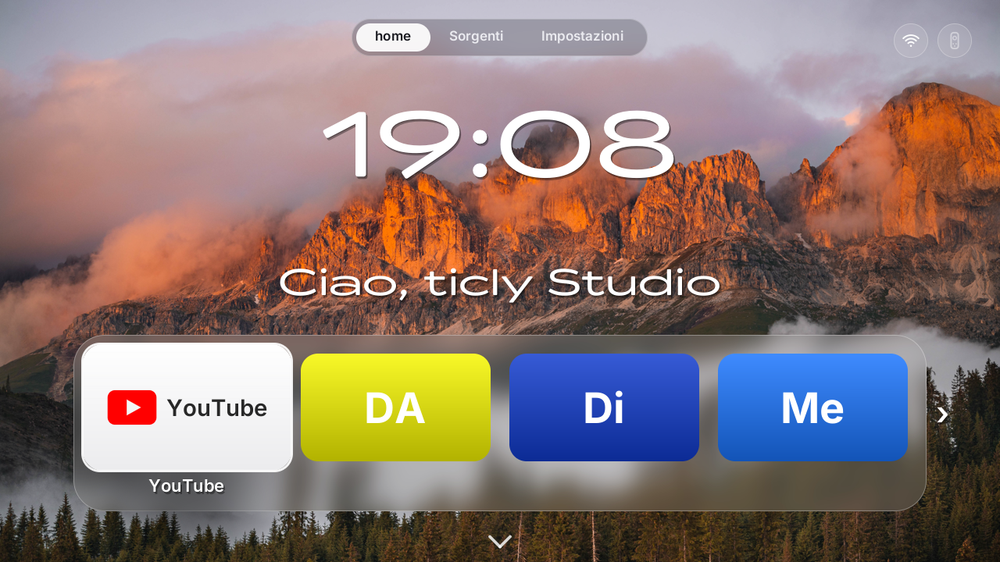
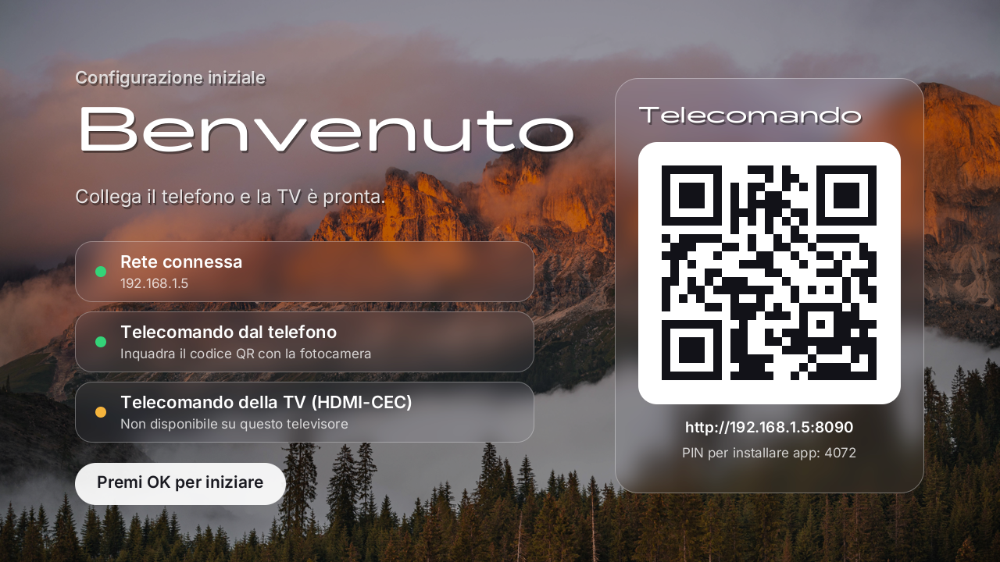
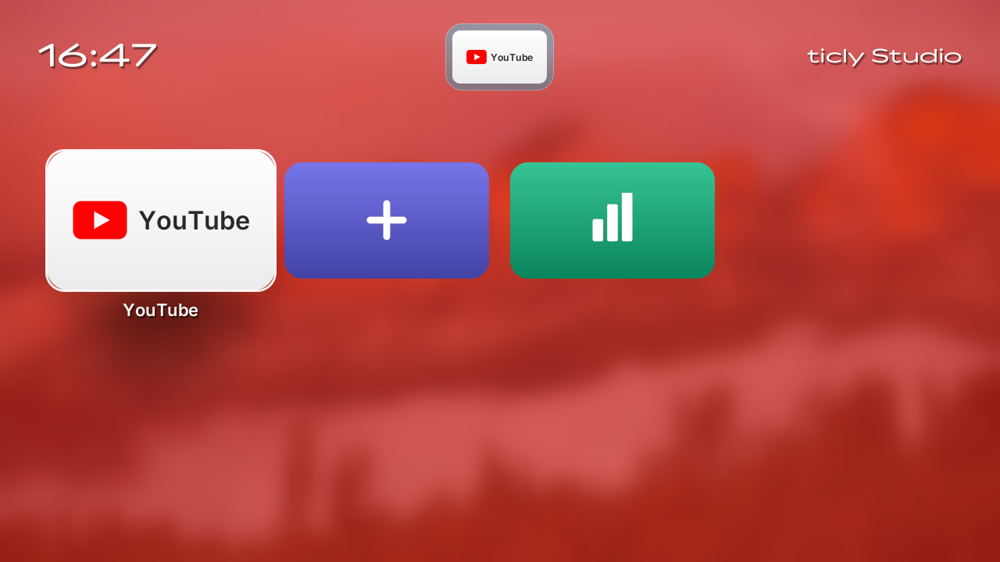
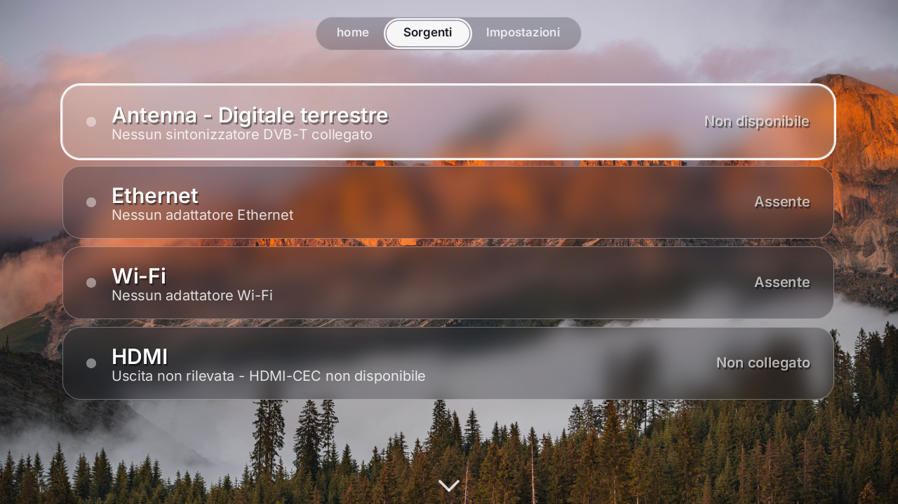
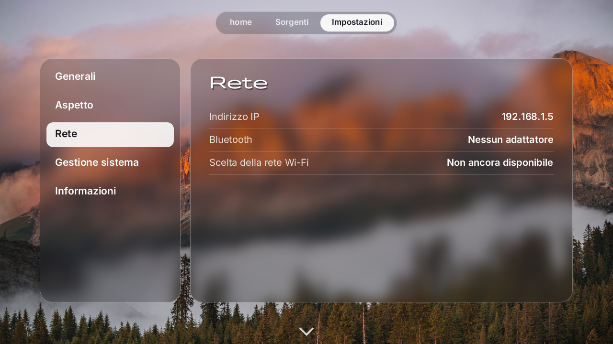
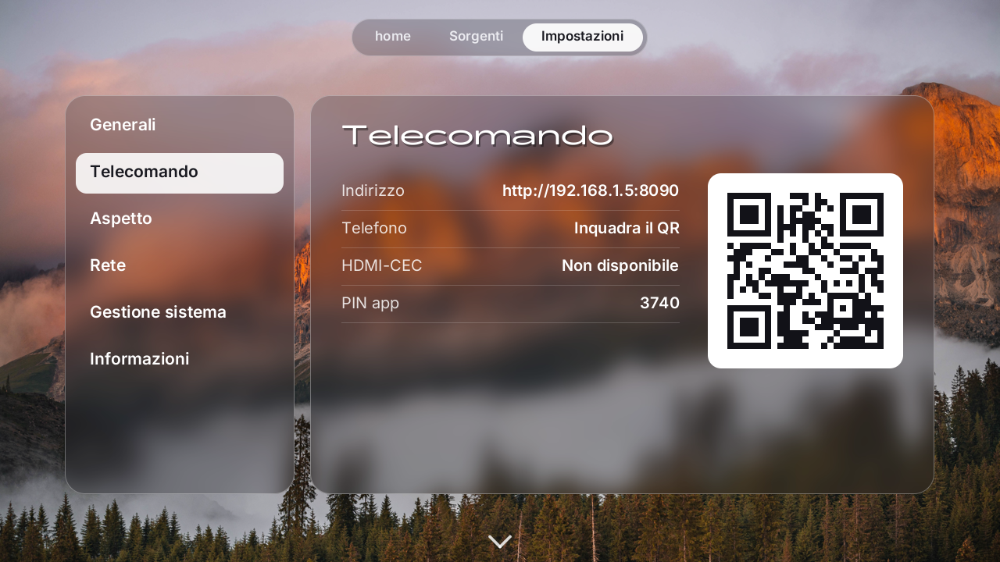
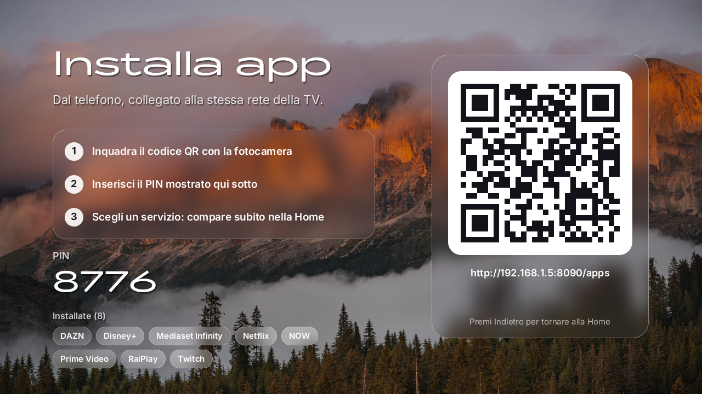

<div align="center">

# TVos

**Un sistema operativo per la TV, leggero, per Raspberry Pi 3B.**
Si accende direttamente sulla Home, si usa con il telecomando della TV o con il telefono e apre YouTube e le web app a schermo intero.

[](https://github.com/matthias-peterlini/TVos/actions/workflows/build.yml)
[](https://github.com/matthias-peterlini/TVos/releases/latest)




</div>

---

## Cosa fa

| | |
|---|---|
| 📺 **Home a schermo intero** | Orologio grande, saluto, app in primo piano e libreria delle app. È tutta disegnata in software dal programma Rust `tvos-shell`, senza desktop né X11. |
| 🎮 **Telecomando della TV** | Funziona via HDMI-CEC con le frecce, OK, Indietro, Home, Play/Pausa e il volume. |
| 📱 **Telecomando dal telefono** | Inquadri il QR code sulla TV e il telefono diventa un telecomando. Non serve installare nessuna app. |
| ▶️ **YouTube e web app** | Si aprono nel browser WPE WebKit (Cog) con accelerazione GPU. |
| 🧩 **Installa app dal telefono** | Una pagina protetta da PIN aggiunge servizi web alla Home. |
| 🌐 **Indirizzo fisso** | Al primo avvio il sistema salva l'indirizzo IP e lo riusa a ogni riavvio, così il QR del telecomando non cambia. |
| ⚡ **Leggero** | Linux minimale costruito con Buildroot e zram. La shell usa pochi MB di RAM sui 1 GB del Pi. |

<table>
  <tr>
    <td><br><sub><b>Primo avvio</b>: QR del telecomando</sub></td>
    <td><br><sub><b>Libreria app</b></sub></td>
  </tr>
  <tr>
    <td><br><sub><b>Sorgenti</b>: stato reale di rete e HDMI</sub></td>
    <td><br><sub><b>Impostazioni</b></sub></td>
  </tr>
  <tr>
    <td><br><sub><b>Telecomando</b>: indirizzo, QR e PIN</sub></td>
    <td><br><sub><b>Installa app</b> dal telefono</sub></td>
  </tr>
</table>

---

## Installazione sul Raspberry Pi 3B

Ti servono un Raspberry Pi 3B (o 3B+), una microSD da almeno 2 GB e un cavo HDMI.

1. **Scarica** `tvos-rpi3.img.xz` dall'[ultima release](https://github.com/matthias-peterlini/TVos/releases/latest).
2. **Scrivi la scheda** con [Raspberry Pi Imager](https://www.raspberrypi.com/software/): *Scegli sistema operativo → Usa immagine personalizzata*. Va bene anche [balenaEtcher](https://etcher.balena.io/). Non serve scompattare il file `.xz`.
3. **Imposta il Wi-Fi.** Togli la scheda e reinseriscila nel PC. Nella partizione **boot** apri `tvos.txt` e compila:
   ```ini
   wifi_ssid=NomeDellaRete
   wifi_password=LaTuaPassword
   youtube_key=            # facoltativa
   ```
   Il Pi 3B usa solo reti Wi-Fi a **2.4 GHz**. Se colleghi il cavo Ethernet puoi saltare questo passaggio.
   Al primo avvio TVos copia i dati nel sistema e cancella password e chiave da `tvos.txt`.
4. **Accendi** il Pi collegato alla TV. Compare la **configurazione iniziale** con il QR code: inquadralo con il telefono per avere subito il telecomando, poi premi OK.

> Il primo indirizzo ottenuto dal router viene salvato e riusato a ogni riavvio, così l'URL del telecomando (`http://<ip>:8080`) resta sempre lo stesso.
> Se un altro dispositivo ha preso quell'indirizzo, TVos se ne accorge e ne chiede uno nuovo.

### Macchina virtuale

`tvos-vm-x86_64.iso` si avvia in VirtualBox o QEMU (BIOS, almeno 1 GB di RAM, rete in bridge) e gira tutta in RAM:

```bash
qemu-system-x86_64 -m 2048 -cdrom tvos-vm-x86_64.iso -nic user,hostfwd=tcp::8080-:8080
```

---

## Provarlo sul PC (simulatore)

```bash
cargo run --release -p tvos-simulator --no-default-features
```

Si apre una finestra 1280×720. Usa le frecce per muoverti, Invio per OK, Esc per Indietro e H per Home. Il telecomando web è su `http://<ip-del-pc>:8090`.
Per rivedere la schermata di configurazione iniziale usa `TVOS_SETUP=1`.

---

## Come è fatto

```
TVos/
├── crates/
│   ├── tvos-core/        grafica software: superfici, testo, sfondo sfocato, icone
│   ├── tvos-apps/        Home, libreria, Sorgenti, Impostazioni, setup, YouTube, QR
│   ├── tvos-shell/       il programma che gira sul Pi: framebuffer, input, avvio del browser
│   ├── tvos-remote-web/  server HTTP: telecomando per il telefono e pagina "Installa app"
│   ├── tvos-cec/         HDMI-CEC (/dev/cec0)
│   ├── tvos-store/       app installate
│   ├── tvos-simulator/   finestra desktop per sviluppare sul PC
│   └── tvos-baremetal/   esperimento bare-metal AArch64 (non usato nell'immagine)
├── os/                   tree esterno Buildroot
│   ├── configs/          defconfig per Raspberry Pi 3B e per la VM
│   ├── board/            overlay, script di rete (IP fisso), tvos.txt, post-build
│   ├── patches/          patch ai pacchetti (WPE WebKit)
│   ├── build-pi.sh       costruisce l'immagine per la microSD
│   ├── build-vm.sh       costruisce l'ISO per la VM
│   └── flash-sd.ps1      scrive l'immagine sulla microSD da Windows
└── .github/workflows/    build automatica e release
```

Lo stack di avvio è: firmware del Pi → kernel Linux → BusyBox init. Gli script di init fanno tre cose:

- `S40config` importa `tvos.txt`;
- `S41network` attiva Ethernet o Wi-Fi e applica l'IP fisso;
- `tvos-shell` parte come unico programma in primo piano.

Quando apri YouTube o una web app, la shell lascia lo schermo a Cog/WPE e lo riprende quando chiudi.

### Costruire l'immagine in locale

Serve Linux o WSL2 con le dipendenze di [Buildroot](https://buildroot.org/downloads/manual/manual.html#requirement) e Rust:

```bash
wget https://buildroot.org/downloads/buildroot-2026.08.1.tar.xz && tar xf buildroot-2026.08.1.tar.xz -C ~
os/build-pi.sh        # → out/tvos-rpi3.img  (la prima volta richiede un paio d'ore: WebKit)
```

Se esistono i file locali `.secrets/wifi.conf` (riga 1: rete, riga 2: password) e `.secrets/youtube_api_key`, vengono inclusi nell'immagine. Sono ignorati da git e non finiscono mai nel repository né nelle release.

### Release automatiche

Ogni push su `main` esegue i test e costruisce le due immagini su GitHub Actions. Le trovi negli *artifacts* della run.
Un tag `v*` le pubblica anche come release:

```bash
git tag v0.2.0 && git push origin v0.2.0
```
